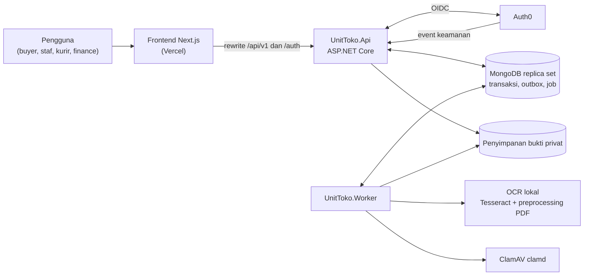
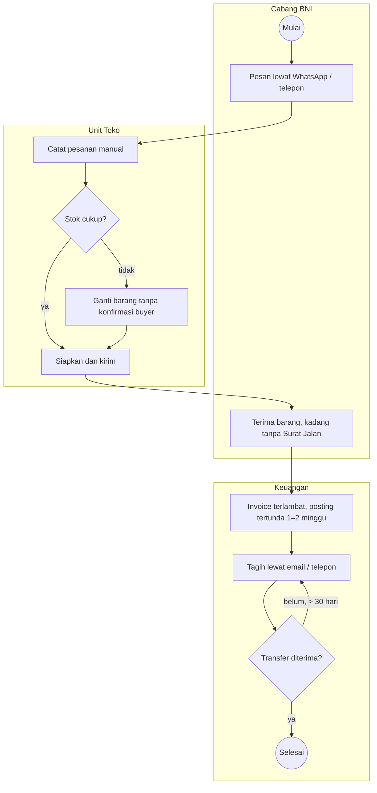
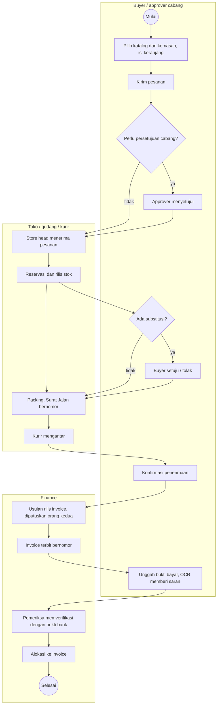
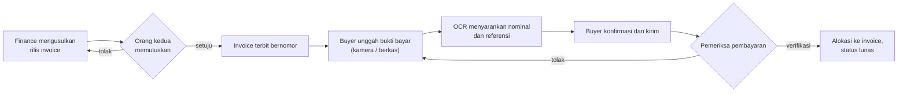
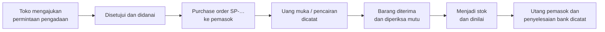
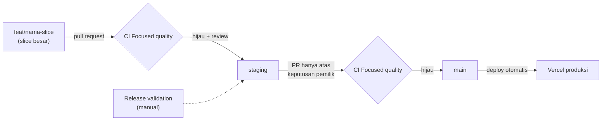

<p align="center">
  
</p>

<h1 align="center">Unit Toko</h1>

<p align="center">
  Platform operasional toko koperasi untuk cabang BNI dan akun bisnis yang disetujui.<br>
  <a href="https://github.com/natannielz/Capstone/actions/workflows/quality.yml"></a>
</p>

## Apa itu Unit Toko

Unit Toko menggantikan pemesanan lewat WhatsApp, telepon dan berkas terpisah dengan satu aplikasi: katalog dan kemasan, keranjang dan pesanan cabang, persetujuan, stok, pengadaan ke pemasok, pengiriman dengan Surat Jalan bernomor, bukti penerimaan, invoice, bukti pembayaran dengan bantuan OCR, peninjauan bank dan alokasi, retur/refund, laporan dan tutup periode. Cakupan lengkapnya adalah [97 butir laporan](docs/requirements/unit-toko-report-2026-09-28.md) dan [spesifikasi produksi](docs/requirements/unit-toko-production.md).

### Siapa yang memakai (persona)

Akses diberikan dari enam templat peran ([izin](docs/architecture/permissions.md)); persetujuan selalu oleh orang yang berbeda dari pengaju.

| Persona | Pekerjaan utama |
| --- | --- |
| Buyer (cabang / akun bisnis) | Katalog, keranjang, pesanan, konfirmasi penerimaan, invoice, bukti bayar, kasus retur |
| Approver cabang | Menyetujui permintaan dan pesanan sesuai kebijakan belanja cabang |
| Store Staff / gudang | Penerimaan barang, hitung stok, packing, dispatch, persiapan pengadaan |
| Store Head | Menerima pesanan, persetujuan pengadaan/stok, penugasan kurir |
| Courier | Pengiriman yang ditugaskan, percobaan antar dan bukti serah terima |
| Finance (paket izin terpisah) | Rilis invoice, pemeriksaan pembayaran, rekonsiliasi bank, utang pemasok, laporan |
| System Admin | Undangan, usulan akses, pengaturan teknis; tanpa wewenang transaksi keuangan |
| Auditor (paket baca saja) | Membaca laporan dan jejak audit tanpa mengubah data |

### Status saat ini

Kemajuan diukur dengan journey end-to-end di [docs/readiness.json](docs/readiness.json): **3 dari 15 journey lulus** (31 Oktober 2026). Catatan harian ada di [docs/progress.md](docs/progress.md).

| ID | Journey | Status |
| --- | --- | --- |
| J01 | Tamu menjelajah katalog contoh lalu masuk | belum |
| J02 | Buyer mengisi keranjang dan checkout | **lulus** |
| J03 | Pesanan → dispatch → penerimaan lintas persona | **lulus** |
| J04 | Rilis invoice → pembayaran buyer terverifikasi | belum |
| J05 | Permintaan pengadaan → barang diterima dan dinilai | belum |
| J06 | Usulan substitusi dan persetujuan buyer | **lulus** |
| J07 | Retur, penggantian, kredit dan refund | belum |
| J08 | Permintaan cabang, kebijakan belanja dan persetujuan | belum |
| J09 | Rekening koran, penerimaan bank dan rekonsiliasi | belum |
| J10 | Laporan dan auditor baca saja | belum |
| J11 | Workspace staf: satu shell, satu antrean | belum |
| J12 | Akun, sign-in, delegasi dan tinjauan akses | belum |
| J13 | Katalog, identifier, foto dan harga dikelola staf | belum |
| J14 | Gudang: pemindaian, sumber stok dan hitung stok | belum |
| J15 | Operasi: rilis, pemantauan dan restore | belum |

[Frontend di Vercel](https://unit-toko-bni.vercel.app/) masih berupa pratinjau; API, worker, MongoDB dan Auth0 hosted belum diterima untuk produksi. Identitas dan data contoh bersifat sintetis.

## Teknologi dan bahasa

Diambil dari kode: [backend/global.json](backend/global.json), berkas `*.csproj`, [frontend/package.json](frontend/package.json) dan [frontend/vercel.json](frontend/vercel.json).

| Lapisan | Teknologi | Bahasa |
| --- | --- | --- |
| Frontend | Next.js 16.4, React 19.3, Tailwind CSS 4, Base UI / Radix / shadcn, React Hook Form + Zod, `openapi-fetch` | TypeScript, CSS |
| Backend API dan worker | ASP.NET Core / .NET SDK 10.0.401 (`UnitToko.Api`, `UnitToko.Worker`, `UnitToko.Modules`, `UnitToko.Platform`), OpenAPI | C# |
| Database | MongoDB replica set dengan transaksi (MongoDB.Driver 3.12; CI memakai `mongo:8.2.12`) | — |
| Identitas | Auth0 lewat OpenID Connect, sesi server dengan cookie opak, Auth0 Actions | C#, JavaScript |
| Dokumen dan OCR | Tesseract 5.5.3 / tesserocr 2.11.0 (model `ind+eng`) sebagai saran untuk pemeriksa manusia, preprocessing PDF, Magick.NET untuk decode gambar, ClamAV (`clamd`) untuk pemindaian berkas | Python, C# |
| Penyimpanan bukti | Penyimpanan privat di sistem berkas lokal yang diperiksa izinnya ([runbook](docs/runbooks/private-evidence-storage.md)) | C# |
| Pengujian | xUnit, `Microsoft.AspNetCore.Mvc.Testing`, Playwright (uji browser dari xUnit dan skrip `frontend/scripts`), uji unit frontend | C#, TypeScript, JavaScript |
| Deployment dan CI | Vercel (frontend, region `sin1`, otomatis hanya dari `main`), GitHub Actions | YAML |
| Skrip operasi | Pilot lokal, restore drill, build rilis | PowerShell |

Tidak ada WebSocket/SignalR: tampilan memuat ulang data dari API.

## Arsitektur sistem



## Proses bisnis

Diturunkan dari [laporan 28 September 2026](docs/requirements/unit-toko-report-2026-09-28.md), [spesifikasi produksi](docs/requirements/unit-toko-production.md) dan [catatan sumber](docs/source-material/README.md). Diagram memakai gaya BPMN: lingkaran = mulai/selesai, belah ketupat = gateway, kolom = lajur peran.

### AS-IS (proses lama)



Masalah utama: pesanan tercecer di chat, substitusi tanpa persetujuan, Surat Jalan hilang, retur yang sulit, invoice terlambat dan penagihan lebih dari 30 hari.

### TO-BE (dengan Unit Toko)



## Journey utama

### Pesanan → dispatch → penerimaan (J03)

```mermaid
flowchart LR
    o1["Buyer kirim pesanan<br/>dari keranjang"] --> o2["Approver cabang meninjau"]
    o2 --> o3["Store head menerima<br/>di meja pesanan"]
    o3 --> o4["Stok direservasi dan dirilis<br/>dari sumber stok"]
    o4 --> o5["Gudang menyiapkan,<br/>Surat Jalan bernomor"]
    o5 --> o6["Kurir ditugaskan,<br/>pengiriman berangkat"]
    o6 --> o7["Buyer konfirmasi penerimaan"]
    o7 --> o8["Timeline pesanan<br/>menampilkan setiap nomor"]
```



### Invoice → pembayaran (J04)



### Pengadaan (J05)



## Alur branch, PR dan CI



- Perbaikan kecil, dokumen dan konfigurasi boleh ikut di branch yang sedang berjalan.
- **Focused quality** ([quality.yml](.github/workflows/quality.yml)) berjalan pada setiap pull request ke `staging` dan `main` (sekitar 5 menit); job dipilih menurut path yang berubah (frontend, backend, supply chain).
- Regresi otoritas transaksional (uji MongoDB, lebih dari 30 menit) tidak berjalan pada PR. Bila PR mengubah path identitas/otorisasi/stok, CI memberi peringatan; jalankan Focused quality secara manual (`workflow_dispatch`) di branch itu sebelum merge.
- **Release validation** ([release-validation.yml](.github/workflows/release-validation.yml)) hanya dijalankan manual.
- `main` men-deploy ke Vercel produksi, jadi merge `staging` → `main` hanya atas keputusan pemilik.

## Menjalankan secara lokal

| Kebutuhan | Panduan |
| --- | --- |
| Instalasi, API lokal, regenerasi kontrak | [docs/runbooks/local-development.md](docs/runbooks/local-development.md) |
| Pilot lokal (Windows) | [docs/runbooks/local-pilot-release1.md](docs/runbooks/local-pilot-release1.md) |
| OCR lokal | [docs/runbooks/local-document-processing.md](docs/runbooks/local-document-processing.md) |
| Alur per peran | [docs/runbooks/user-workflows.md](docs/runbooks/user-workflows.md) |
| Runbook lain (pembayaran, pengadaan, gudang, restore, …) | [docs/runbooks/](docs/runbooks/) |

### Pemeriksaan

```bash
npm --prefix frontend run typecheck
npm --prefix frontend run lint
npm --prefix frontend test
```

Uji backend dijalankan per kelas xUnit yang tepat (bukan seluruh suite) terhadap MongoDB replica set uji; lihat [pengembangan lokal](docs/runbooks/local-development.md). Uji browser memakai Playwright dari kelas `*BrowserTests`.

## Struktur repositori

| Direktori | Isi |
| --- | --- |
| [frontend/](frontend/) | Aplikasi Next.js: halaman, [modul UI](frontend/src/modules/), klien API hasil generate |
| [backend/](backend/) | API dan worker .NET, modul bisnis, migrasi, [kontrak API](backend/contracts/), OCR lokal, integrasi Auth0, alat pilot |
| [docs/](docs/) | Persyaratan, arsitektur, runbook, bukti penerimaan, rencana dan [papan readiness](docs/readiness.json) |
