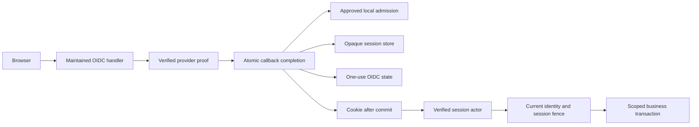

# Identity foundation

Status: T03 integration in progress. API startup registers the concrete identity runtime when explicitly enabled with validated provider settings and persistent protected keys; the default remains unavailable.

## Boundaries

Auth0 supplies verified provider identity and actual factor evidence. MongoDB supplies approved account binding, membership, delegated scope, session liveness and immutable approvals. Equal email addresses never link established identities.

This diagram describes the integrated local flow. Full-host tests exercise it with an isolated provider and real MongoDB. Actual Auth0 deployment, complete browser/proxy rehearsal and release acceptance remain separate gates.

## Source ownership

| Layer | Responsibility |
| --- | --- |
| `UnitToko.Modules/Identity/Contracts` | Provider proof, admission, session reference, timeout policy and actor assurance |
| `UnitToko.Modules/Identity/OnboardingPolicy.cs` | Email comparison, bounded invitation period, explicit role materialization and approval revalidation |
| `UnitToko.Api/Identity` | OIDC options/claims/events, exact returns, configured opaque handler/resolver, atomic completion, native identity routes and browser request protections |
| `UnitToko.Platform/Identity` | Mongo sessions/state/admission/invitations/profiles/recovery and protected payloads |
| `UnitToko.Platform/Authorization/AuthorizationStore.cs` | Current identity, optional persistent-session validation and transaction fences |
| `UnitToko.Platform/Mongo/Migrations/IdentityMigration.cs` | Explicit v4 schema/index/counter upgrade |
| `backend/integrations/auth0/v1` | Unapplied tenant policy draft and ordered OTP Action fixtures |

Production actors must carry `SessionReference`. Its omission is retained for trusted in-process domain tests, not an HTTP fallback. The configured resolver obtains it only from the handler's verified request feature; submitted role/user headers and the old demo cookie cannot create that feature.

## Persistent records

| Collection | Stored authority or evidence |
| --- | --- |
| `identities` | Unique issuer/subject, local status, grant version, optional historical security epoch initialized during verified admission |
| `identitySessions` | Random-token hash, family/account/binding/version metadata, explicit deadlines and encrypted provider payload |
| `oidcTransactions` | Hashed one-use state and challenge, expected account/session/versions/operation or invitation binding |
| `accountInvitations` | Reserved IDs, intended verified email, reviewed provider/connection, scope/role, independent approval and secret hash |
| `accountProfiles` | Provider display attribute and verified email; no legal-name claim or unique email identity rule |
| `identityProviderIntents` | Encrypted invitation/recovery payloads, blocked until a separately authorized dispatcher exists |
| `identityReadEvents` | Purpose, actor, safe selection, scopes and result count |
| `authorizationHistory` | Minimal immutable invitation/recovery decision evidence; no raw secrets or email copies |

TTL indexes clean expired sessions/state; authorization explicitly checks deadlines. Deployment history version 4 remains separate from identity document schema version 1. Earlier migrations are frozen.

## Session and recovery invariants

Ordinary requests can extend idle expiry up to the original absolute deadline. They never refresh factor evidence. Sensitive permissions require actual OTP completion within five minutes. OIDC primary `auth_time`, token issue time and cookie issue time cannot substitute for this evidence.

Step-up binds the current browser session and expected local/provider identity to a short-lived server challenge. It rotates the opaque token while keeping the original session family and absolute deadline. A delayed logout using the old family cookie closes its rotated descendant. A step-up callback does not execute the business action; the caller must review and submit it separately under current authorization.

The callback transaction rereads and consumes OIDC state together with admission and session issuance. Failure rolls back all local effects; no session cookie is returned before commit. An uncertain commit may leave an inaccessible session until expiry, but is never reported as verified success.

Recovery revokes local sessions and increments the security epoch before recording a blocked provider intention in the same transaction. A blocked intention is not a provider password/factor reset or a completed owner recovery. See [account recovery](../runbooks/account-recovery.md).

## Configuration and acceptance

Shared protected key construction requires an existing absolute key directory, a stable application discriminator, a current private RSA certificate and retained prior decryption certificates as needed. The library does not prove actual mount sharing, ACL isolation, secret-manager integration or backup/restore. The API wiring is implemented and tested across separate local host instances. Actual infrastructure controls and restore must still be accepted before deployment.

The Auth0 adapter is disabled by default. The tenant draft contains no actual issuer, client, connection, region, callbacks or secrets. Local synthetic provider tests exercise maintained middleware and real Mongo transactions; they do not establish tenant entitlement, actual Action event semantics, email delivery, external factor-change revocation or production-origin behavior. The [research record](../research/2026-09-28-auth0-integration.md) and [acceptance register](../quality/production-acceptance.md) retain those gates.

## Connected API and screens

The configured API exposes session/CSRF reads and strict URL-encoded login, step-up and local logout forms. Every unsafe browser API/auth request requires exact origin and real anti-forgery validation. Explicit trusted proxies are processed before canonical HTTPS origin validation, and only the maintained query callback is exempt from unsafe-request token checks. Identity documents are available at `/identity/login` and `/identity/account`, with current-account and permitted administration navigation. Existing legacy commerce remains its own migration baseline; these screens do not port its business writers.

Identity invitation/recovery command outcomes now participate in the existing actor-owned durable operation reconciliation. Results disclose only typed references, status and relevant revisions; local recovery remains `blocked`, never a claim of provider completion. Historical result formats normalize without rewriting recorded outcomes. Current scope/delegation and fresh owner recovery evidence are rechecked. See [hosting and browser boundary](../runbooks/identity-hosting.md) for configuration and remaining acceptance gates.