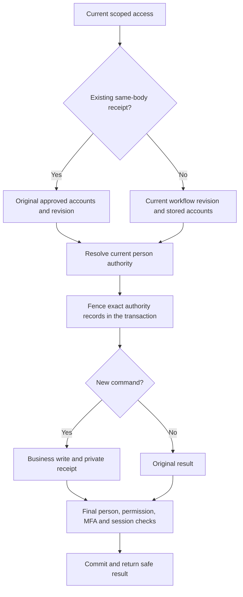

# Current person authority and approval integration

This contract covers ACC03's local person-proof producer and the shared business-command consumer. The approved staff source, independently authorized reviewers, governed source/binding/equivalence commands, exception review, finance conflict matrix, template migration and real activation remain open in [report decisions](../quality/report-decisions.md). Synthetic database fixtures establish test conditions only.

## Identity and storage boundaries

Provider issuer/subject identifies an account. It does not prove a person. Names, email addresses and matching provider profiles never create verified person authority. Six base role templates remain unchanged.

Migration v8 adds five private collections with strict typed fields and independent account review provenance. It does not seed authority or rewrite migrations v1–v7.

| Collection | Meaning |
| --- | --- |
| personEvidenceSources | Explicitly reviewed source, adapter and policy version with status and validity |
| personRecords | Stable source/person reference and current immutable evidence/equivalence pointers |
| personAccountBindings | Reviewed account-to-person binding with status, validity and independent reviewer |
| personEquivalenceGroups | Complete current account/person group and canonical person, preserving superseded groups |
| personEvidenceVersions | Append-only reviewed evidence with private source reference/hash, source version and provenance |

IDs/revisions use positive BSON Int64; schema versions use exact Int32; operational fence counters are nonnegative Int64. Mutable authority heads keep separate semantic versions and fence counters. Evidence versions are immutable. An evidence record's createdAt means creation of the reviewed immutable record; reviewedAt cannot follow creation. Evidence may have become effective before it was reviewed. Resolution requires current source/evidence/binding validity and no review or creation date in the future.

Migration preflights all five collections, complete existing links, identities, duplicate keys, counters, options and indexes before creating or changing any of them. Existing stronger validators and compatible indexes are preserved; expiring/capped proof storage is rejected. Deployment migrations remain explicit and use majority writes.

## Resolution and transaction protocol

PersonRegistryService resolves selected positive unique account IDs inside the caller's Mongo transaction. Unknown bindings produce Unknown evidence. Malformed, incomplete, disputed, inactive or ambiguous selected authority cannot authorize an approval. Current equivalence determines canonical person identity; old financial account history is never rewritten.

The internal proof retains each exact typed source/person/binding/group/evidence record and its validity. Public PersonEvidence contains only account ID, canonical person ID, verification status and a positive revision. That projection cannot be supplied back as a trusted transaction proof. Private source references, subjects and digests stay inside the platform.

Resolution verifies complete current group membership, overlapping groups and all involved account/reviewer identity records. Historical identity records may be inactive. The selected account binding needs current validity; an inactive alias remains in the completeness graph without requiring an active login.

PersonAuthorizationFence accepts only the same transaction's server-created proof. It matches exact semantic BSON fields and types, fences each mutable authority head and rechecks validity around awaited operations. Operational fence increments do not invalidate otherwise unchanged semantic evidence. Immutable evidence is read and bound through fenced current pointers and source versions.

Every future governed writer must update the affected old and new group heads in the same transaction, including insertion of an account binding, a new person pointer or a competing equivalence relationship. This serializes membership changes that a snapshot query could otherwise miss. Writers must append evidence, preserve history, audit independent review and invalidate affected identity/session authority. Direct uncoordinated database writes are not a supported authority mutation protocol. These writer endpoints are not delivered by the producer checkpoint.

## Business command and retry contract

Any denial aborts the transaction. This diagram applies to the shared sensitive business-command boundary below.

ExecuteAuthorizedAsync retains current scope, membership, MFA, account-ID independence and exact workflow revision checks. Independently checked approvals additionally resolve and fence the actor and immutable server-loaded historical participants in the same transaction before any business effect. Period close requires three distinct people; other actions preserve their existing actor-versus-participant relationships.

A successful sensitive command privately records its original permission and ApprovalRequest account IDs/revisions alongside the idempotent receipt. It stores no staff-source evidence in that metadata and never returns it as the business result. Same-body replay authorizes current scope and fresh MFA, parses the exact original approved participant record, and resolves/fences current person authority again. It does not re-run the completed workflow revision or repeat the business effect. Missing, malformed or wrong-permission person metadata fails closed; existing older sensitive receipts require explicit reconciliation.

After the business write and receipt update, current person validity, permission effectivity, MFA and session validity are checked again before returning for commit. A denial rolls back the business effect and receipt. A late equivalence discovery can deny later commands or result replay, but never edits or reverses a completed financial fact automatically.

Owning modules must load the exact target and immutable maker/checker history from server records inside the supplied session, declare the exact permission and keep resource ownership immutable or serialize ownership changes. API/user input cannot choose original participants. Real payment/order/period command ports still need their owning business rules, approved finance matrix, audit/exception flows and end-to-end acceptance.

Access/membership approval participant mappings are defined in the pure person policy, but the specialized administration/invitation services do not yet consume this new producer. Their governed integration, account-link review, finance conflict preview/activation and template migration remain ACC03 work. This checkpoint must not be described as complete staff verification or production financial readiness.
